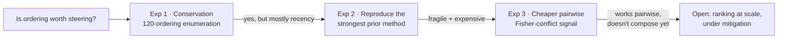

# Task Ordering as a Predictive Signal in Continual Learning

**▶ [Interactive demo](https://cyrchanh.github.io/msc-thesis-demo-task-ordering/)**. It runs in the browser with nothing to install. You can also clone the repo and open `index.html`.

*MSc Machine Learning thesis, University College London, 2026. Hei Chan.
Supervised by Prof. Philip Treleaven (UCL CS) and Dr Omer Gunes (Oxtractor Ltd.).*
When a neural network learns tasks one after another, it forgets the earlier ones, and how much it
forgets depends on the **order** of the tasks. Most continual-learning research asks how to stop the
forgetting. This thesis asks a practitioner's question:

> **Can a cheap signal tell you a good task order *before* you train, without trying all n! of them?**

| | |
|---|---|
| **120 / 120** | orderings trained exhaustively, so every predictor is scored against exact ground truth |
| **2.5×** | spread in mean forgetting (0.271 → 0.665) caused by order alone |
| **R² ≈ 0.96** | of that spread explained by *which task is trained last* |
| **97.9%** | of the accuracy gap recovered by a frozen backbone, so the damage is in the readout |
| **65%** | pre-training hit rate for a Fisher-based pairwise signal (p = 0.046, dependence-robust) |

---

## The three experiments

### 1. Is total forgetting conserved? No, and the mechanism is localised.
Split-MNIST, five two-digit tasks, an MLP with one shared output head, all 120 orderings over two seeds.
- Forgetting is **not** a fixed budget that order merely redistributes. Order moves it by 2.5×.
- Nearly all of that comes from **recency**. The last task alone explains R² ≈ 0.96. Once the last task is fixed, the first four positions sit at the seed-noise floor.
- The effect belongs to the **shared head**. With one head per task, the last-task range collapses from 0.277 to 0.057, and the worst task to put last becomes the best.
- **Mechanism:** a fresh linear probe on the frozen backbone recovers a median **97.9%** of the gap. CKA shows the backbone *does* drift (0.72 → ~0.47). The features reorganise without losing information, and the frozen classifier just can't follow them.

### 2. Reproducing Bell & Lawrence (2022): direction holds, significance doesn't.
The prior method orders tasks along a max-curvature path over an *asymmetric* distance matrix. Turning that
into a general matrix-and-solver pipeline forces an **orientation** choice (which axis means "source"), and significance depends on it:
- Under the paper's orientation, the effect is at the significance boundary on CIFAR-100, marginal on MNIST, and null on gratings and CIFAR-10.
- On gratings, changing only the base seed **flips which orientation is significant**.
- Choosing the orientation after seeing the data inflates the family-wise error rate by up to 3×. A standard Bonferroni correction within one orientation doesn't catch it. This is a reproducibility risk for any asymmetric-matrix ordering method.
- I audited the code line by line and checked it numerically. A suspicious control "failure" turned out to be a target value that the source paper never reported.

### 3. A cheap pre-training signal from machinery you already run.
EWC-style regularisation already computes Fisher importances. I repurposed them as a **conflict score**: how hard does a
candidate next task push on the weights the current task relies on? The score is computed from one converged model, before the candidate is trained.
- Two confounds had to be fixed first: comparing Fisher matrices across independently initialised networks (a basis-alignment problem), and the two-task design collapsing into "which task is more fragile?".
- A **victim-isolated** three-task design lifts the hit rate from 46.7% to **65.0%** on 60 triples. With within-victim permutation the result is p = 0.046, and the cluster-bootstrap 95% CI is [0.517, 0.767].
- It is **directional but not calibrated**, and it **does not compose** into a full-sequence ranking. Greedy and Kemeny aggregation both pick the worst ordering. Adding a recency term only helps when that term is an oracle.

## The meta-finding

Across all three experiments, **16 candidate results were deliberately re-tested against a nuisance variable that
shouldn't have mattered**. Six collapsed, four survived, three weakened, and three exposed a regime where the quantity couldn't be measured at all.
The same check was applied to null results, not only to positive ones. The [demo](https://cyrchanh.github.io/msc-thesis-demo-task-ordering/#discipline) has the full, filterable table.

> In this class of problem, a plausible effect is provisional until it survives a deliberate variation of
> at least one nuisance choice that should not, in principle, matter.

## Skills this project exercised

- **Experimental design:** exhaustive ground truth, confound isolation (victim-isolated design, matched edge manipulations), and pre-registered predictions.
- **Statistics:** dependence-aware inference (within-block permutation, cluster bootstrap), multiple-comparison control, and spotting pseudoreplication.
- **Deep learning internals:** Fisher information and EWC variants, Hessian-vector products, CKA, linear probing, and readout vs. representation diagnostics.
- **Reproducibility engineering:** orientation audits, determinism and precision-invariance checks, and provenance gates on cached artefacts.

## Limits and next steps

- Everything runs at n = 5 or 6 so that ground truth is exact. Whether the signal pays off at n ≳ 10 (10! > 3.6M orderings) is the deciding question.
- On Split-CIFAR-10, retention floors at chance across a 30-config capacity sweep. That floor is structural, so testing recency off the ceiling needs fewer tasks or a retention mechanism.
- Still open: does any ordering benefit survive EWC or replay? And how do Fisher conflict, curvature and CKA compare in a bake-off?

## About this repository

This repo is a **public explainer**. It contains the interactive demo page and this summary. Every number shown is
a reported result from the thesis. The research code and the full thesis are not published here.
For questions, get in touch via [GitHub](https://github.com/cyrchanh).

*The exhaustive enumerations were made possible by compute from Oxtractor.*
